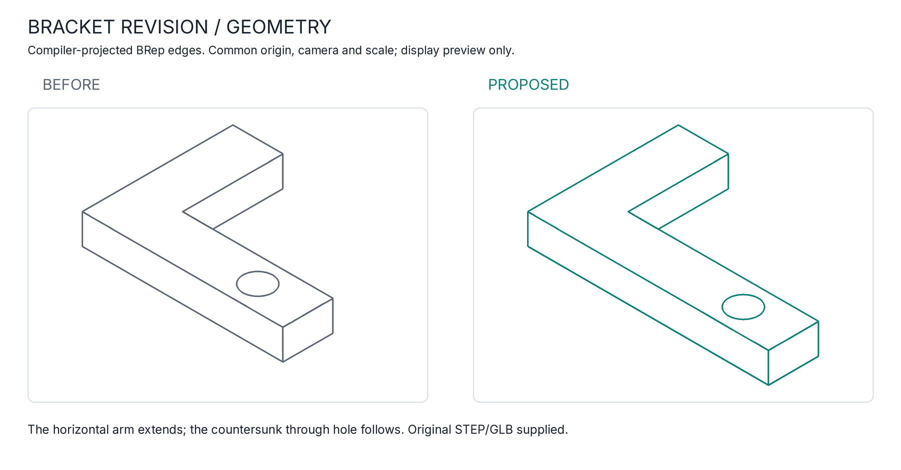
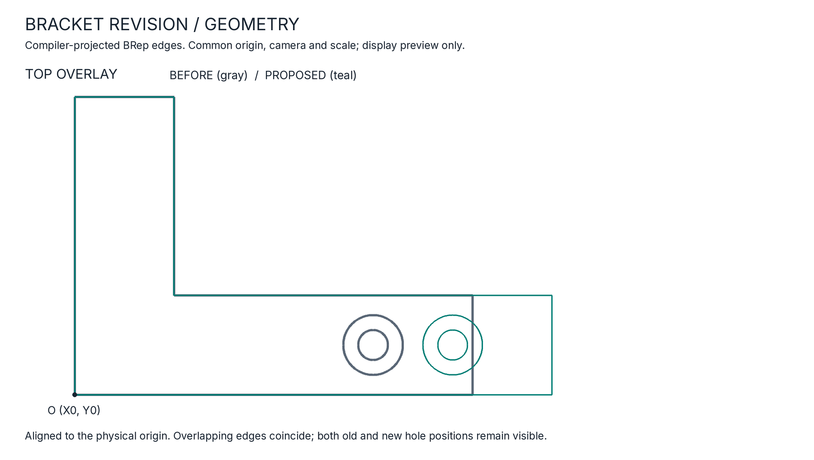
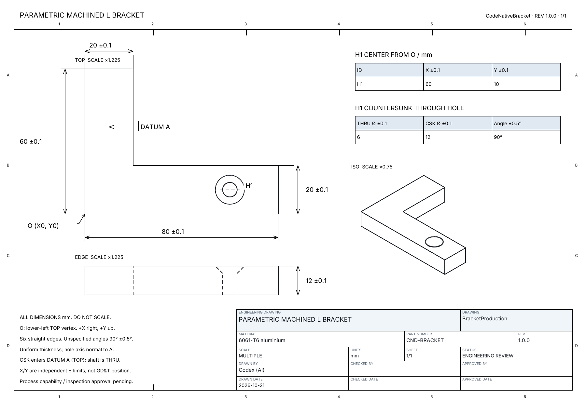
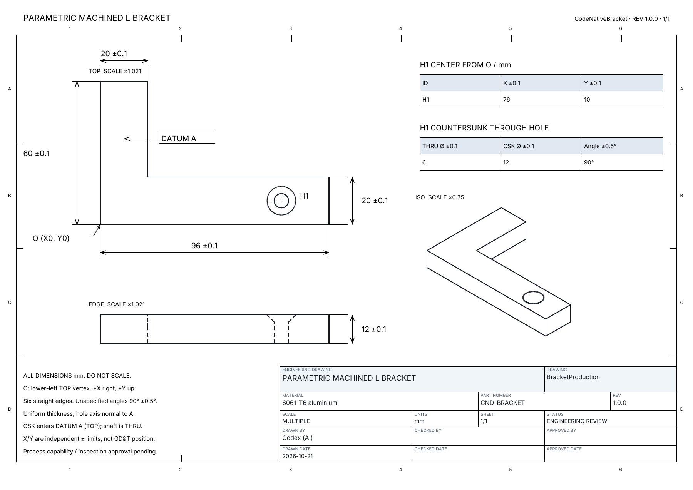

# Review a bracket revision

This is [PR #1](https://github.com/yuechen-li-dev/CodeNativeDesignDemo/pull/1):
extend the nominal horizontal arm and move its countersunk mounting hole outward,
preserving the 20 mm distance from the hole center to the right edge.

The part-source change is two named values in `src/Program.cs`:

```diff
-    Width: 80, Height: 60, LegWidth: 20, LegHeight: 20, Thickness: 12,
-    HoleX: 60, HoleY: 10, ShaftDiameter: 6, EntryDiameter: 12),
+    Width: 96, Height: 60, LegWidth: 20, LegHeight: 20, Thickness: 12,
+    HoleX: 76, HoleY: 10, ShaftDiameter: 6, EntryDiameter: 12),
```

| Requirement | Before | Proposed |
| --- | ---: | ---: |
| Overall width | 80 mm | 96 mm |
| H1 X from O | 60 mm | 76 mm |
| Right edge to hole center | 20 mm | 20 mm |
| Height / thickness | 60 / 12 mm | 60 / 12 mm |
| Vertical / horizontal leg widths | 20 / 20 mm | 20 / 20 mm |
| Through / countersink entry diameter | 6 / 12 mm | 6 / 12 mm |
| Countersink included angle | 90° | 90° |

## See the geometry

Both previews use actual compiler-projected BRep edge points. The comparison
removes the drawing's page origin/scale and applies one camera and one common
scale. The before and proposed shapes share the physical coordinate origin.
No part is redrawn from the parameter table to make the preview.



The overlay shows the added arm length and the old/new hole positions. Gray is
the base; teal is the proposal. Shared edges coincide.



## Review the drawings

Each is the original generated PDF rendered to a preview. Open the full-size
images to inspect the dimensions and hole schedule. The downloaded review pack
contains the original searchable PDFs, STEP AP242, GLB and their provenance.

### Before



### Proposed



The controlling width changes to 96 mm and the hole schedule changes X to 76 mm.
The origin, thickness, hole diameters/extent, countersink angle, material and
limits remain explicit. Drawings may select different page scales; use the
common-scale geometry comparison above to judge size changes visually.

## Follow the evidence

The PR workflow rebuilds the exact base commit and the proposed merge candidate
using the same pinned Aetheris compiler. Both nominal and control parts on each
side must compile, reimport, preserve supported PMI and reconstruct from their
PDFs. The complete review pack includes an offline `index.html`, both sets of
deliverables and `comparison.json`.

The [producing CI run](https://github.com/yuechen-li-dev/CodeNativeDesignDemo/actions/runs/39709965174)
passed all 35 focused compiler regressions and qualified all four built cases,
including 36 rejected incomplete-drawing mutations. The inline screenshots below
were downloaded from its [review artifact](https://github.com/yuechen-li-dev/CodeNativeDesignDemo/actions/runs/39709965174/artifacts/12396364703)
and verified against its recorded image hashes before being archived here.
The producer rebuilt base `64ee70615d5144199b73e717bd568f987d893538` and proposed
merge candidate `017fafb77b1873ac050808b4aae83883630e0700`; Aetheris remained
`81918d9c14a624f1168cd3919c2df4cc0c8b27ba` on both sides. PR source head for that
run was `f7c20e7e9757f4d5f25108b733c07c285a3cc41e`.

The added 16 × 20 × 12 mm section predicts **+3,840.0 mm³**. The analytic
construction-volume delta and independently evaluated reimported BRep mass-volume
delta must agree with that prediction. The unchanged resized control must retain
byte-identical STEP and PDF. Datum and shaft semantic requirements must be
preserved. An unchanged nominal result, altered qualified PDF or changed compiler
pin is rejected rather than presented as a successful revision review.

The screenshots are deliberately retained as small documentation assets so a
public PR reader can see the change without downloading an artifact or opening
CAD. Full generated models and drawings stay in ignored local output and CI
artifacts. The accompanying [comparison receipt](bracket-revision/comparison.json)
records the producing revisions, run URL and screenshot hashes. It is a snapshot
of that producing run, not a claim that screenshots update themselves.

These remain unsigned engineering-review drawings. Git commits identify the
working design states; the drawing family's planned release remains 1.0.0 until
a release decision. Checked/approved fields are blank. This PR proposes a revision
and leaves `main` unchanged while it is reviewed.
